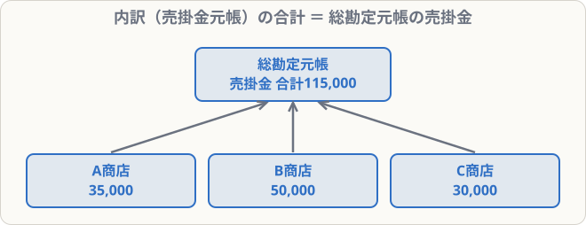

# 売掛金元帳・買掛金元帳・手形記入帳

## まず覚えること

- **売掛金元帳（得意先元帳）**：得意先ごとに、売掛金の増減と残高を記録する。
- **買掛金元帳（仕入先元帳）**：仕入先ごとに、買掛金の増減と残高を記録する。
- 各元帳の残高の合計は、**総勘定元帳の売掛金（買掛金）勘定の残高と一致**する。

## しくみ

総勘定元帳の売掛金勘定は「全体の合計」、売掛金元帳は「得意先ごとの内訳」です。

## 売掛金元帳（A商店）の例

| 日付 | 摘要 | 借方 | 貸方 | 借/貸 | 残高 |
|---|---|--:|--:|---|--:|
| 4/1 | 前月繰越 | 30,000 | | 借 | 30,000 |
| 4/10 | 売上 | 50,000 | | 借 | 80,000 |
| 4/12 | 返品 | | 5,000 | 借 | 75,000 |
| 4/25 | 普通預金で回収 | | 40,000 | 借 | 35,000 |

売掛金は資産なので、**増えたら借方、減ったら貸方**。仕訳の左右と同じです。

## 受取手形記入帳・支払手形記入帳

手形ごとに、**手形の種類・番号・振出人（受取人）・振出日・満期日・金額・てん末（どうなったか）** を記録します。

| 日付 | 手形種類 | 手形番号 | 支払人 | 振出日 | 満期日 | 金額 | てん末 |
|---|---|---|---|---|---|--:|---|
| 5/1 | 約手 | 12 | D商店 | 5/1 | 7/31 | 100,000 | 7/31 入金 |

「**てん末**」欄に、期日に入金されたなどの結末を書きます。試験では、この記入帳から仕訳を逆算させる問題が出ます。

## 覚え方のコツ

- 売掛金元帳は「**得意先別の売掛金勘定**」と考えれば、書き方は勘定と同じ。
- 「てん末」が書いてある日付＝その手形が**決済された日**。
