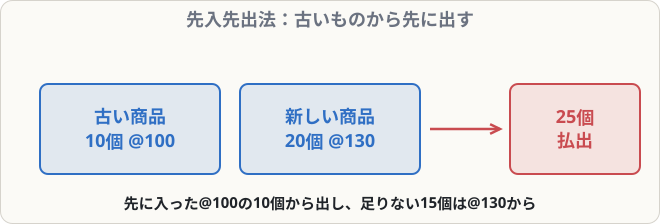

# 商品有高帳（先入先出法）

## まず覚えること

- **商品有高帳**：商品の種類ごとに、**受入・払出・残高**を「数量・単価・金額」で記録する。
- 金額はすべて**原価（仕入単価）**で書く。売った値段（売価）は書かない。
- **先入先出法**：**先に仕入れたものから先に払い出した**とみなして単価を決める。

## なぜ単価の決め方が必要なのか

同じ商品でも、仕入れた時期によって単価が違うことがあります。100円で仕入れたものと130円で仕入れたものが混ざっているとき、売った商品の原価をいくらにするかを決めるルールが必要です。

## 記入例（商品X）

> 4/1 前月繰越 10個 @100円
> 4/5 仕入 20個 @130円
> 4/10 売上 25個（売価@200円）

| 日付 | 摘要 | 受入 数量 | 単価 | 金額 | 払出 数量 | 単価 | 金額 | 残高 数量 | 単価 | 金額 |
|---|---|--:|--:|--:|--:|--:|--:|--:|--:|--:|
| 4/1 | 前月繰越 | 10 | 100 | 1,000 | | | | 10 | 100 | 1,000 |
| 4/5 | 仕入 | 20 | 130 | 2,600 | | | | 10 | 100 | 1,000 |
| | | | | | | | | 20 | 130 | 2,600 |
| 4/10 | 売上 | | | | 10 | 100 | 1,000 | | | |
| | | | | | 15 | 130 | 1,950 | 5 | 130 | 650 |

- 単価が違うものは**行を分けて**書きます（4/5の残高、4/10の払出）。
- 4/10の払出（売上原価）＝ 1,000 ＋ 1,950 ＝ **2,950円**

## 売上総利益の計算

| 項目 | 金額 |
|---|--:|
| 売上高（25個 × @200） | 5,000 |
| 売上原価（払出金額） | 2,950 |
| **売上総利益** | **2,050** |

## よくあるミス

- 払出欄に**売価（@200）**を書いてしまう → 商品有高帳は**すべて原価**。
- 単価の違う残高をまとめてしまう → 先入先出法では**行を分ける**。
