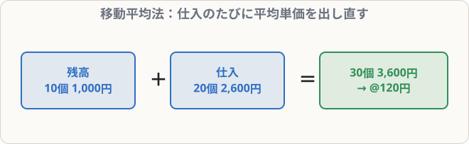

# 商品有高帳（移動平均法）

## まず覚えること

- **移動平均法**：仕入のたびに、**（残高の金額 ＋ 仕入の金額）÷（残高の数量 ＋ 仕入の数量）**で新しい平均単価を計算する。
- 払い出すときは、その時点の**平均単価**を使う。
- 返品（仕入戻し）は、**仕入れたときの単価**で受入欄から差し引くのが基本。

## 記入例（BK08-04と同じ取引）

> 4/1 前月繰越 10個 @100円
> 4/5 仕入 20個 @130円
> 4/10 売上 25個（売価@200円）

4/5の平均単価 ＝（1,000 ＋ 2,600）÷（10 ＋ 20）＝ 3,600 ÷ 30 ＝ **@120円**

| 日付 | 摘要 | 受入 数量 | 単価 | 金額 | 払出 数量 | 単価 | 金額 | 残高 数量 | 単価 | 金額 |
|---|---|--:|--:|--:|--:|--:|--:|--:|--:|--:|
| 4/1 | 前月繰越 | 10 | 100 | 1,000 | | | | 10 | 100 | 1,000 |
| 4/5 | 仕入 | 20 | 130 | 2,600 | | | | 30 | 120 | 3,600 |
| 4/10 | 売上 | | | | 25 | 120 | 3,000 | 5 | 120 | 600 |

売上原価 ＝ **3,000円**、売上総利益 ＝ 5,000 − 3,000 ＝ **2,000円**

## 先入先出法との比較

| | 先入先出法 | 移動平均法 |
|---|--:|--:|
| 売上原価 | 2,950 | 3,000 |
| 売上総利益 | 2,050 | 2,000 |
| 月末の残高 | 650（@130） | 600（@120） |

仕入単価が上がっているときは、先入先出法の方が売上原価が小さくなり、利益が大きく出ます。

## 解き方のコツ

- 仕入のたびに「**残高の金額＋仕入金額**」と「**残高の数量＋仕入数量**」を計算 → 割る。
- 売上（払出）では単価は変わらない。次の仕入まで同じ単価。
- 試験の問題は、**月末の残高**や**売上総利益**を答えさせることが多いので、最後まで計算しましょう。
