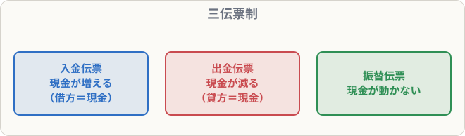

# 伝票（三伝票制）

## まず覚えること

- **三伝票制**：取引を **入金伝票・出金伝票・振替伝票** の3種類の伝票に書く方法。
- **入金伝票**：現金が増える取引（借方は必ず現金なので、**相手の貸方科目だけ**書く）。
- **出金伝票**：現金が減る取引（貸方は必ず現金なので、**相手の借方科目だけ**書く）。
- **振替伝票**：現金が動かない取引（普通の仕訳と同じく左右を書く）。

## なぜ伝票を使うのか

仕訳帳は1冊なので、1人しか書けません。伝票なら**1取引1枚**なので、何人もの担当者が同時に記録でき、取引の証拠としても残せます。

## 起票の例

**商品30,000円を売り上げ、代金は現金で受け取った** → 入金伝票

| 入金伝票 | |
|---|--:|
| 売上 | 30,000 |

**消耗品費5,000円を現金で支払った** → 出金伝票

| 出金伝票 | |
|---|--:|
| 消耗品費 | 5,000 |

**商品80,000円を掛けで仕入れた** → 振替伝票

| 借方 | 金額 | 貸方 | 金額 |
|---|--:|---|--:|
| 仕入 | 80,000 | 買掛金 | 80,000 |

## 一部が現金の取引（試験に頻出）

**商品100,000円を売り上げ、代金のうち30,000円は現金で受け取り、残りは掛けとした**

### 方法①：取引を分ける

| 伝票 | 内容 |
|---|---|
| 入金伝票 | 売上 30,000 |
| 振替伝票 | （借）売掛金 70,000 （貸）売上 70,000 |

### 方法②：いったん全額を掛けとみなす

| 伝票 | 内容 |
|---|---|
| 振替伝票 | （借）売掛金 100,000 （貸）売上 100,000 |
| 入金伝票 | 売掛金 30,000（すぐに一部を回収したとみなす） |

試験では、**片方の伝票が示されて、もう片方を答える**形がよく出ます。入金伝票の科目が「売上」なら方法①、「売掛金」なら方法②と判断できます。

## 覚え方のコツ

- 「**入金伝票の左は必ず現金、出金伝票の右は必ず現金**」。だから書かない。
- 一部現金の取引は、**振替伝票の金額**を見れば、どちらの方法か一発でわかる。
