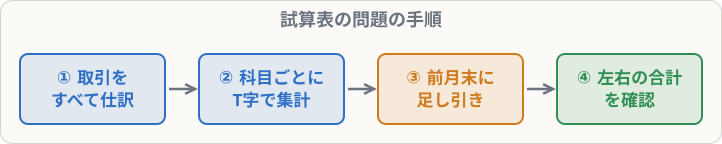

# 試算表の問題の解き方

## まず覚えること

- よくある形：「**前月末の残高試算表**」＋「**今月の取引**」→「**今月末の試算表**」を作る。
- 解き方は、**① 取引をすべて仕訳 → ② 科目ごとに集計 → ③ 前月末の残高に足し引き**。
- 最後に**左右の合計が一致するか**を必ず確認する。

## 解き方の手順

### ① 仕訳を書く（下書き）

問題文の取引を、1つずつ仕訳します。同じ種類の取引（例：「掛け売上 合計200,000円」）はまとめて1つの仕訳にしてかまいません。

### ② 科目ごとに集計する

下書き用紙に、よく出てくる科目（現金・普通預金・売掛金・買掛金・売上・仕入など）の**T字勘定**を書き、仕訳の金額を書き込みます。

### ③ 前月末の残高と合計する

| 科目 | 前月末残高 | ＋増加 | −減少 | 今月末残高 |
|---|--:|--:|--:|--:|
| 売掛金 | 150,000 | 200,000 | 180,000 | 170,000 |

資産なら「残高 ＋ 借方 − 貸方」、負債・純資産・収益なら「残高 ＋ 貸方 − 借方」。

### ④ 合計を確認

借方合計と貸方合計が一致すれば完成。一致しなければ、**差額の金額**から間違いを探します（差額が2で割り切れるなら、左右を逆に書いた可能性）。

## 時間を節約するコツ

- 現金・預金のように**動きが多い科目から**集計する。
- 「売掛金の回収」「買掛金の支払い」は、**相手の科目もセット**で動くことを忘れない。
- 本試験では、試算表の問題は**第3問**で出ることがあります（第12章の財務諸表と同じくらいの重さ）。
