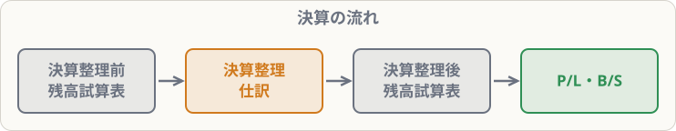

# 決算の流れと決算整理

## まず覚えること

- 決算の流れ：**決算整理前残高試算表 → 決算整理仕訳 → 決算整理後残高試算表 → 損益計算書・貸借対照表**。
- **決算整理**：期中の記録を、期末の**正しい状態に直す**作業。
- 主な決算整理事項は8つ。これが第3問の中心になる。

## なぜ決算整理が必要なのか

期中の記録は「お金が動いたとき」を中心に書いています。でも、それだけでは**当期の正しいもうけ**になりません。たとえば、

- 1年分の保険料を払ったが、そのうち一部は**来期の分**
- 仕入れた商品のうち、一部が**売れ残っている**
- 建物は使っている分だけ**価値が減っている**

こうしたズレを、決算日に直すのが決算整理です。

## 3級の主な決算整理事項

| 事項 | 内容 | 単元 |
|---|---|---|
| ① 現金過不足・仮払金などの整理 | 原因不明の差額や仮の科目を正しく直す | BK11-02 |
| ② 貯蔵品 | 使っていない切手・印紙を資産にする | BK11-02 |
| ③ 貸倒引当金 | 売掛金などが回収できなくなる分に備える | BK11-03 |
| ④ 売上原価 | 売れた商品の原価を計算する | BK11-04 |
| ⑤ 減価償却 | 固定資産の価値の減少を費用にする | BK11-05 |
| ⑥ 消費税・法人税等 | 納める税金を計算する | BK11-05 |
| ⑦ 経過勘定（前払・前受） | 来期の分を除く | BK11-06 |
| ⑧ 経過勘定（未払・未収） | 当期の分を加える | BK11-07 |

## 決算整理の考え方の基本

> **「当期の収益と費用は、当期の分だけにする」**

お金を払ったかどうかではなく、**当期に関係する分か**で考えるのがポイントです。これを**発生主義**といいます。
