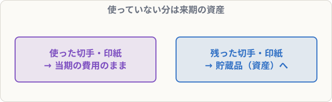

# 現金過不足・仮払金などの整理と貯蔵品

## まず覚えること

- **現金過不足**が残っていたら、原因がわかった分は正しい科目へ、残りは**雑損・雑益**へ（BK02-02）。
- **仮払金・仮受金**は、内容が判明したら正しい科目に振り替える。決算日まで残しておかない。
- 期末に使っていない**郵便切手・収入印紙** → 通信費・租税公課から**貯蔵品**（資産）に振り替える。

## 現金過不足の整理

**決算整理前の現金過不足（借方残高）3,000円のうち、2,000円は支払家賃の記入漏れ、残りは不明**

| 借方科目 | 金額 | 貸方科目 | 金額 |
|---|--:|---|--:|
| 支払家賃 | 2,000 | 現金過不足 | 3,000 |
| 雑損 | 1,000 |  |  |

> 現金過不足が**借方**に残っている＝現金が**足りなかった**ということ。不明分は雑損。

## 仮払金・仮受金の整理

**仮受金50,000円は、得意先からの売掛金の回収と判明した**

| 借方科目 | 金額 | 貸方科目 | 金額 |
|---|--:|---|--:|
| 仮受金 | 50,000 | 売掛金 | 50,000 |

## 貯蔵品

**期中に郵便切手10,000円を購入して通信費、収入印紙20,000円を購入して租税公課で処理していたが、期末に切手3,000円、印紙5,000円が未使用で残っていた**

| 借方科目 | 金額 | 貸方科目 | 金額 |
|---|--:|---|--:|
| 貯蔵品 | 8,000 | 通信費 | 3,000 |
|  |  | 租税公課 | 5,000 |

### なぜ貯蔵品にするのか

切手や印紙は、買ったときに費用にしています。でも、使っていない分は**当期の費用ではなく、来期に使える資産**です。だから決算で費用から差し引き、資産（貯蔵品）にします。

翌期首には、**再振替仕訳**で元の費用に戻します（BK12-04）。

| 借方科目 | 金額 | 貸方科目 | 金額 |
|---|--:|---|--:|
| 通信費 | 3,000 | 貯蔵品 | 8,000 |
| 租税公課 | 5,000 |  |  |

## 当座預金の貸方残高

当座預金が貸方残高（マイナス）なら、**当座借越**（または借入金）に振り替えます（BK02-04）。
