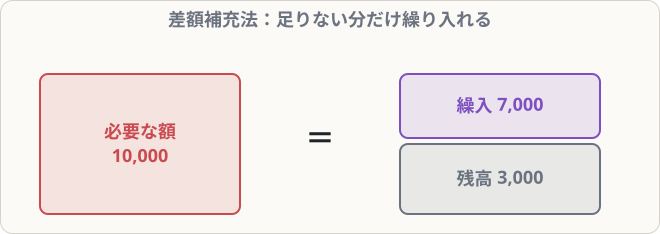

# 貸倒れと貸倒引当金

## まず覚えること

- **貸倒れ**：得意先が倒産するなどして、売掛金や受取手形が回収できなくなること。
- 決算で、来期以降の貸倒れに備えて **貸倒引当金**（資産のマイナス）を設定する。費用は **貸倒引当金繰入**。
- 3級は**差額補充法**：必要な引当金の額と、今残っている引当金の**差額だけ**を繰り入れる。

## 貸倒引当金の設定

**決算：売掛金の期末残高500,000円に対し、2％の貸倒引当金を設定する（差額補充法）。貸倒引当金の残高は3,000円**

必要な額 ＝ 500,000 × 2％ ＝ **10,000円**
繰入額 ＝ 10,000 − 3,000 ＝ **7,000円**

| 借方科目 | 金額 | 貸方科目 | 金額 |
|---|--:|---|--:|
| 貸倒引当金繰入 | 7,000 | 貸倒引当金 | 7,000 |

### もし残高の方が多かったら

必要額10,000円、残高12,000円 → 2,000円多すぎるので戻す：

| 借方科目 | 金額 | 貸方科目 | 金額 |
|---|--:|---|--:|
| 貸倒引当金 | 2,000 | 貸倒引当金戻入 | 2,000 |

（貸倒引当金戻入は収益）

## なぜ引当金を設定するのか

当期に売った商品の代金が、来期に回収できなくなることがあります。その損失は、**売上を計上した当期の責任**です。そこで、過去の経験から「このくらいは回収できないだろう」という額を、**先に当期の費用**にしておきます。

## 実際に貸倒れたとき

| いつ発生した売掛金？ | 処理 |
|---|---|
| **前期以前**の売掛金 | まず**貸倒引当金**を取り崩す。足りない分は貸倒損失 |
| **当期**に発生した売掛金 | 全額を**貸倒損失**（費用） |

**前期に発生した売掛金30,000円が貸し倒れた。貸倒引当金の残高は20,000円**

| 借方科目 | 金額 | 貸方科目 | 金額 |
|---|--:|---|--:|
| 貸倒引当金 | 20,000 | 売掛金 | 30,000 |
| 貸倒損失 | 10,000 |  |  |

**当期に発生した売掛金15,000円が貸し倒れた**

| 借方科目 | 金額 | 貸方科目 | 金額 |
|---|--:|---|--:|
| 貸倒損失 | 15,000 | 売掛金 | 15,000 |

> 当期の売掛金に備えた引当金はまだ作っていないので、引当金は使えません。

## 前期に貸倒れ処理したものを回収したとき

**前期に貸倒れとして処理した売掛金のうち5,000円を、現金で回収した**

| 借方科目 | 金額 | 貸方科目 | 金額 |
|---|--:|---|--:|
| 現金 | 5,000 | 償却債権取立益 | 5,000 |

## 覚え方のコツ

- 繰入額は「**必要額 − 残高**」。
- 「**前期の売掛金 → 引当金を使う、当期の売掛金 → 貸倒損失**」。
