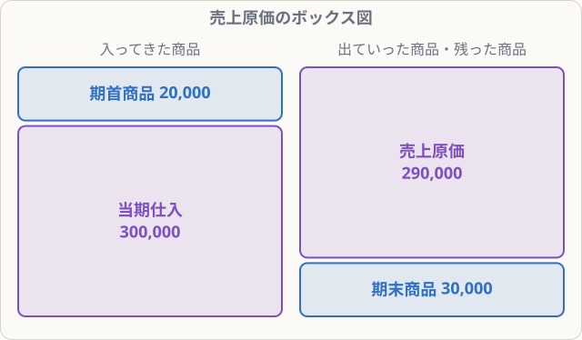
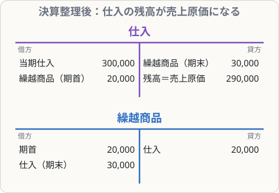

# 売上原価の計算（しくりくりし）

## まず覚えること

- 売上原価 ＝ **期首商品棚卸高 ＋ 当期商品仕入高 − 期末商品棚卸高**。
- 仕訳は **「し・くり／くり・し」**（仕入勘定で売上原価を計算する）：

| 借方科目 | 金額 | 貸方科目 | 金額 |
|---|--:|---|--:|
| 仕入 | 期首 | 繰越商品 | 期首 |
| 繰越商品 | 期末 | 仕入 | 期末 |

- 決算整理後の**仕入勘定の残高 ＝ 売上原価**、**繰越商品 ＝ 期末の在庫**。

## なぜこの計算が必要なのか

三分法では、期中に買った商品を全部「仕入」（費用）にしています。でも、

- **去年の売れ残り**（期首商品）は、今年売れたので**今年の費用**に加えるべき
- **今年の売れ残り**（期末商品）は、まだ売れていないので**今年の費用から除くべき**

これを直して、**売れた分の原価（売上原価）だけを費用にする**のがこの決算整理です。

## 仕訳の例

**期首商品棚卸高20,000円、当期仕入高300,000円、期末商品棚卸高30,000円**

| 借方科目 | 金額 | 貸方科目 | 金額 |
|---|--:|---|--:|
| 仕入 | 20,000 | 繰越商品 | 20,000 |
| 繰越商品 | 30,000 | 仕入 | 30,000 |

- 1行目：期首の在庫（繰越商品）を仕入に移す ＝ 費用に**加える**
- 2行目：期末の在庫を仕入から除いて繰越商品にする ＝ 費用から**除く**

売上原価 ＝ 20,000 ＋ 300,000 − 30,000 ＝ **290,000円**

## 売上総利益

売上高が450,000円なら、売上総利益 ＝ 450,000 − 290,000 ＝ **160,000円**。

## 覚え方のコツ

- 「**しーくり・くりしー**」と声に出して覚える。1行目は**期首**、2行目は**期末**の金額。
- 決算整理前の繰越商品の残高 ＝ **期首**の在庫。問題文の「期末商品棚卸高」とまちがえないように。
- ボックス図（左：期首＋仕入、右：売上原価＋期末）を描くと計算ミスが減ります。
