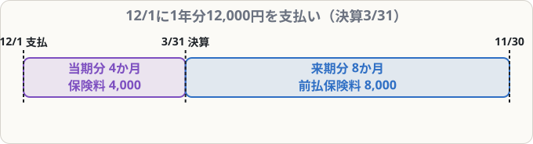

# 経過勘定①（前払費用・前受収益）

## まず覚えること

- 当期に払った費用のうち、**来期の分** → **前払費用**（資産）に振り替える。例：前払保険料・前払家賃。
- 当期に受け取った収益のうち、**来期の分** → **前受収益**（負債）に振り替える。例：前受家賃・前受地代。
- これを**繰延べ**という。翌期首に再振替仕訳で元に戻す。

## なぜ必要なのか

12月1日に、1年分の保険料12,000円を払ったとします（決算日3月31日）。当期にかかわるのは12月〜3月の**4か月分（4,000円）**だけです。残りの**8か月分（8,000円）は来期の分**なので、当期の費用から除かなければなりません。

## 前払費用の例

**12月1日に1年分の保険料12,000円を現金で支払っていた。決算日（3月31日）に、来期分を繰り延べる**

来期分 ＝ 12,000 × 8/12 ＝ **8,000円**

| 借方科目 | 金額 | 貸方科目 | 金額 |
|---|--:|---|--:|
| 前払保険料 | 8,000 | 保険料 | 8,000 |

保険料（費用）が8,000円減り、当期の費用は4,000円になります。前払保険料は「来期にサービスを受けられる権利」なので資産です。

## 前受収益の例

**2月1日に、土地を貸して6か月分の地代60,000円を受け取っていた（決算日3月31日）**

当期分：2月・3月の2か月、来期分：4か月 ＝ 60,000 × 4/6 ＝ **40,000円**

| 借方科目 | 金額 | 貸方科目 | 金額 |
|---|--:|---|--:|
| 受取地代 | 40,000 | 前受地代 | 40,000 |

前受地代は「来期に土地を貸す義務」なので負債です。

## 覚え方のコツ

- 「**前に払った → 前払（資産）、前に受け取った → 前受（負債）**」。
- 仕訳は「**費用・収益を減らして、前払・前受を作る**」。
- 時間の線（タイムライン）を描いて、**決算日より右側（来期）**の月数を数えましょう。
