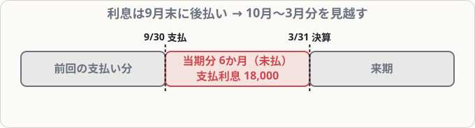

# 経過勘定②（未払費用・未収収益）

## まず覚えること

- 当期にサービスを受けたのに、**まだ払っていない費用** → **未払費用**（負債）。例：未払利息・未払家賃。
- 当期にサービスを提供したのに、**まだ受け取っていない収益** → **未収収益**（資産）。例：未収利息・未収地代。
- これを**見越し**という。翌期首に再振替仕訳で元に戻す。

## なぜ必要なのか

銀行から借りたお金の利息を、半年ごとの「後払い」で払う約束だとします。決算日の時点で、まだ払っていなくても、**借りていた期間の利息は当期の費用**です。払った日ではなく、**当期に関係する分**で考えるのが決算整理のルールでした（発生主義）。

## 未払費用の例

**借入金1,200,000円（年利率3％、利息は毎年9月末に1年分を後払い）。決算日3月31日に、当期分の利息を見越し計上する**

10月1日〜3月31日の**6か月分** ＝ 1,200,000 × 3％ × 6/12 ＝ **18,000円**

| 借方科目 | 金額 | 貸方科目 | 金額 |
|---|--:|---|--:|
| 支払利息 | 18,000 | 未払利息 | 18,000 |

## 未収収益の例

**貸付金500,000円（年利率4％、利息は返済時に受け取る）。当期の貸付期間は3か月**

500,000 × 4％ × 3/12 ＝ **5,000円**

| 借方科目 | 金額 | 貸方科目 | 金額 |
|---|--:|---|--:|
| 未収利息 | 5,000 | 受取利息 | 5,000 |

## 4つの経過勘定のまとめ

| | 費用 | 収益 |
|---|---|---|
| 繰延べ（来期分を除く） | 前払費用（資産） | 前受収益（負債） |
| 見越し（当期分を加える） | 未払費用（負債） | 未収収益（資産） |

## 覚え方のコツ

- 「**前払・未収は資産（もらえる側）、前受・未払は負債（払う・渡す側）**」。
- 仕訳は**費用・収益の科目を必ず使い**、相手に経過勘定を書く。費用を増やす（見越し）か減らす（繰延べ）かを、タイムラインで判断。
- 「未払金」（商品以外の後払い）と「未払費用」（継続するサービスの見越し）は別物。
