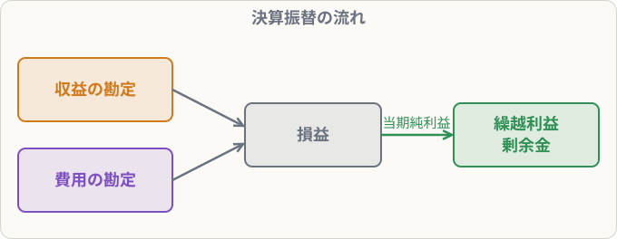

# 帳簿の締め切り

## まず覚えること

- ① 収益・費用の各勘定の残高を、**損益勘定**に振り替える。
- ② 損益勘定の差額（**当期純利益**）を、**繰越利益剰余金**に振り替える。
- ③ 資産・負債・純資産は、**次期繰越**として締め切り、翌期は**前期繰越**から始める。

## なぜ締め切りが必要なのか

収益と費用は、**1年ごとのもうけ**を計算するための科目です。来年は来年のもうけを計算するので、**毎年ゼロにリセット**します。一方、資産・負債・純資産は、会社の財産そのものなので**来年に引き継ぎます**。

## 仕訳の例

**決算整理後の売上450,000円、受取利息5,000円、仕入290,000円、給料60,000円**

① 収益を損益勘定へ

| 借方科目 | 金額 | 貸方科目 | 金額 |
|---|--:|---|--:|
| 売上 | 450,000 | 損益 | 455,000 |
| 受取利息 | 5,000 |  |  |

① 費用を損益勘定へ

| 借方科目 | 金額 | 貸方科目 | 金額 |
|---|--:|---|--:|
| 損益 | 350,000 | 仕入 | 290,000 |
|  |  | 給料 | 60,000 |

② 当期純利益（455,000 − 350,000 ＝ 105,000）を繰越利益剰余金へ

| 借方科目 | 金額 | 貸方科目 | 金額 |
|---|--:|---|--:|
| 損益 | 105,000 | 繰越利益剰余金 | 105,000 |

> 当期純損失のときは逆：（借）繰越利益剰余金 ／（貸）損益

③ 資産・負債・純資産の勘定は、残高を「次期繰越」と書いて締め切ります（仕訳はしない）。

## 覚え方のコツ

- 「**収益・費用は損益へ、損益は繰越利益剰余金へ、財産は次期へ**」。
- 損益勘定は「**もうけを計算するための集計場所**」。
