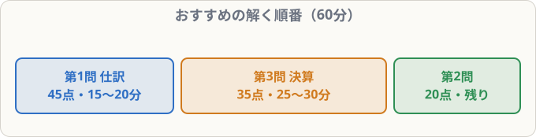

# 試験の形式と合格戦略

## まず覚えること

- **60分・100点満点・70点以上で合格**。第1問45点・第2問20点・第3問35点。
- 時間配分の目安：**第1問 15〜20分 → 第3問 25〜30分 → 第2問 残り**。
- 戦略：**第1問で40点以上、第3問で25点以上**取れば、第2問は半分でも合格ラインに届く。

## 配点と時間の目安

| 問題 | 内容 | 配点 | 時間の目安 |
|---|---|--:|---|
| 第1問 | 仕訳15問 | 45点 | 15〜20分 |
| 第2問 | 補助簿・勘定記入・語句など2問 | 20点 | 10〜15分 |
| 第3問 | 決算（精算表・財務諸表・後T/B） | 35点 | 25〜30分 |

> 第2問は年によって難しさがばらつくので、**第3問を先に**解くのがおすすめです。

## ネット試験と統一試験

| | ネット試験 | 統一試験 |
|---|---|---|
| 日程 | テストセンターで**随時** | 年3回（2月・6月・11月） |
| 解答 | パソコンで入力・選択 | 紙に記入 |
| 結果 | **その場で**わかる | 後日発表 |
| 勘定科目 | **選択肢から選ぶ** | 選択肢から選ぶ |

ネット試験は、日程を選べて、すぐに結果がわかるので受けやすい方式です。計算用紙と電卓は使えます。

## 合格のための勉強法

1. **仕訳を毎日解く**（1日10〜20問）。考えなくても手が動くまで。
2. 決算整理の8つの事項を、**それぞれ説明できる**ようにする。
3. **過去問・予想問題を時間を計って**解く（最低3〜5回分）。
4. 間違えた問題は、**なぜ間違えたか**をノートに書く。

## 本番の心がまえ

- わからない仕訳は**後回し**。1問に3分以上かけない。
- 第3問は、**部分点**がある。全部できなくても、わかるところから埋める。
- 最後の5分は、**見直し**（特に科目の選び間違い・金額の桁）。
